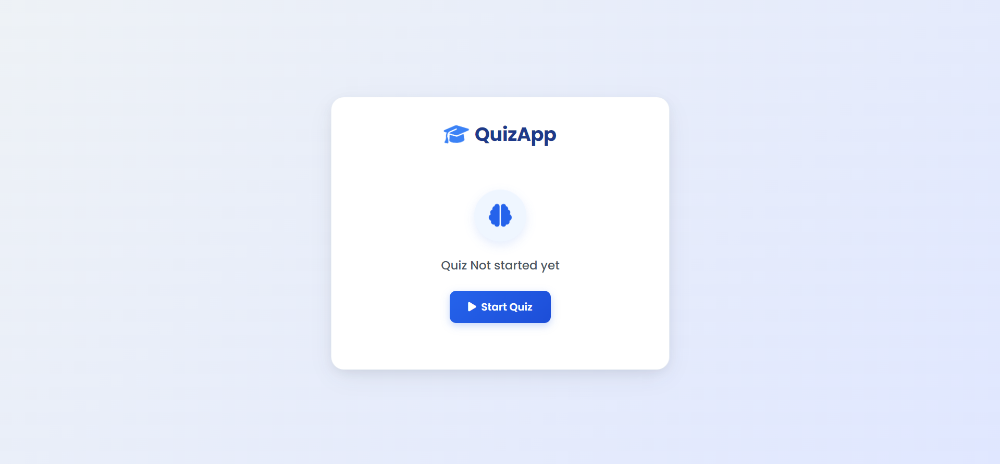
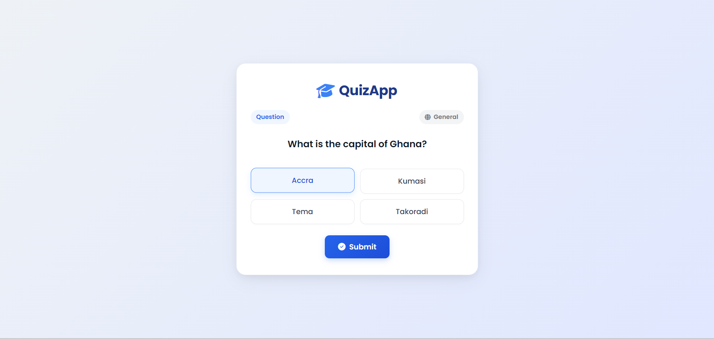

# 🎓 QuizApp — Interactive DOM Manipulation Tutorial

A beginner-friendly JavaScript project designed to teach students the fundamentals of **DOM manipulation**, event handling, and interactive web application logic using pure HTML, CSS, and Vanilla JavaScript.

---

## 📸 Preview

### Start Screen


### First Question Screen


---

## 🎯 Purpose & Learning Goals

This repository serves as a practical, step-by-step classroom tutorial. It demonstrates how to bring a static webpage to life with JavaScript:

- **DOM Selection**: Accessing elements with `document.getElementById` and `document.querySelector`.
- **Event Listeners**: Listening for user clicks using `addEventListener`.
- **Dynamic Element Creation**: Generating buttons and inserting content into the page using `document.createElement` and `appendChild`.
- **State Management**: Managing app screens (switching between the start screen and active quiz view).
- **Array Traversal**: Working with data structures (questions, options, and answer keys) using an index pointer.

---

## 🚀 How to Clone and Run

You do not need to install Node.js, npm, or any build tools to run this project.

1. **Clone this repository** to your computer:
   ```bash
   git clone https://github.com/kwasihenri/JsDon-QuizTutorial1.git
   ```

2. **Navigate into the folder**:
   ```bash
   cd JsDon-QuizTutorial1
   ```

3. **Open the project**:
   - Open `quiz.html` directly in any web browser (Chrome, Edge, Firefox, Safari) by double-clicking the file.
   - Alternatively, open the folder in **VS Code** and use the **Live Server** extension if you have it installed.

---

## 📂 Project Structure

```text
├── .gitignore          # Files and folders to ignore in Git
├── index.js            # JavaScript logic (current classroom starter code)
├── quiz.html           # Structure of the quiz app and UI screens
├── style.css           # Styling, smooth transitions, and responsive layout
├── README.md           # Project documentation and guide
└── screenshots/        # Visual previews of the application
    ├── start-quiz-page.png
    └── quiz-que-1.png
```

---

## 💻 Current JavaScript State (`index.js`)

The project currently has the foundation in place for teaching:

- ✅ **Data Storage**: Quiz questions, answer choices, and correct answers defined in simple arrays.
- ✅ **Start Quiz Flow**: When the "Start Quiz" button is clicked, the welcome screen hides, and the active quiz screen appears.
- ✅ **Dynamic Question & Option Loading**: The current question text is set, and choice buttons are generated dynamically inside the `#options` container.

### 📝 Next Steps for Students

Students can practice extending `index.js` with the following exercises:
1. **Selection Feedback**: Add click listeners to option buttons to highlight the selected answer.
2. **Submit & Answer Validation**: Compare the selected choice against `quizAnswers[currentQuestionIndex]`.
3. **Score Tracking**: Increment the `score` variable when the user chooses correctly.
4. **Question Progression**: Advance `currentQuestionIndex` to load the next question until all questions are completed.
5. **Results Screen**: Display the final score on the `#results` screen and enable the "Play Again" button.
